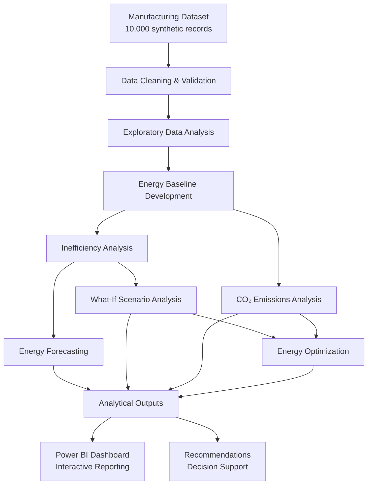
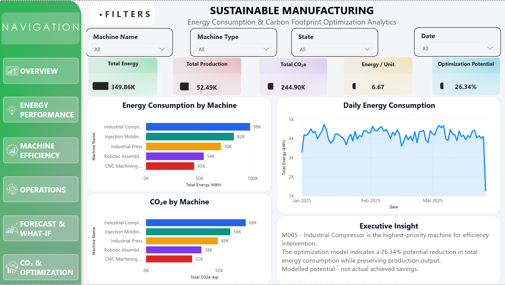
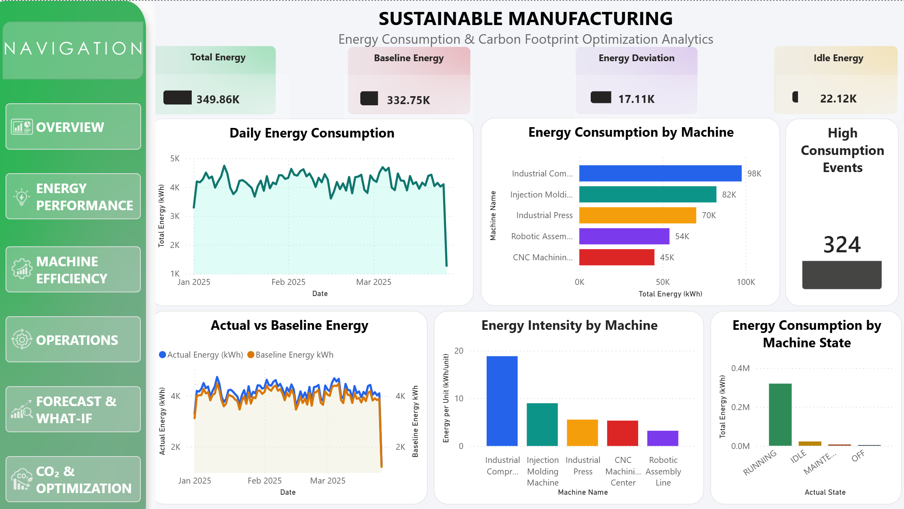
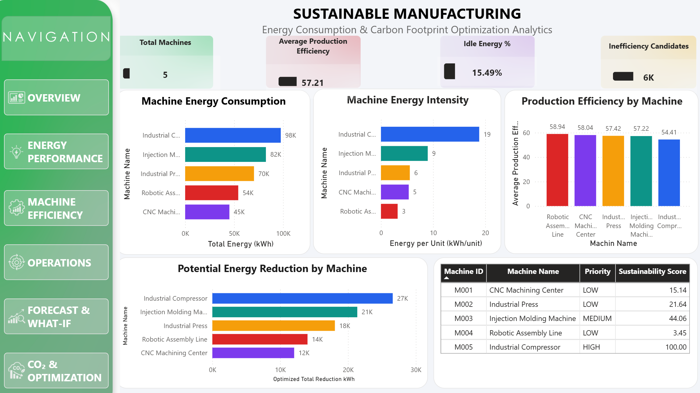
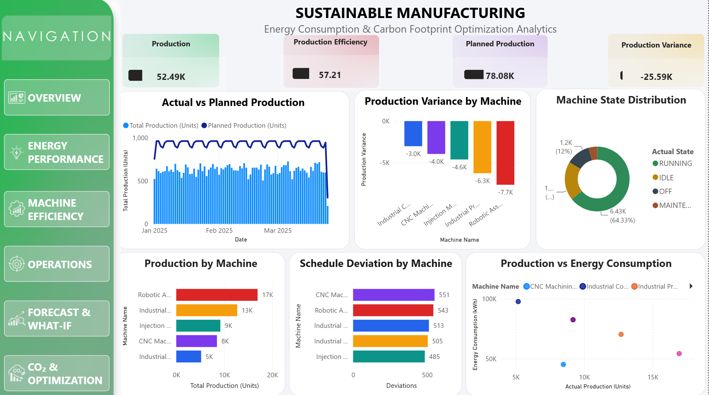
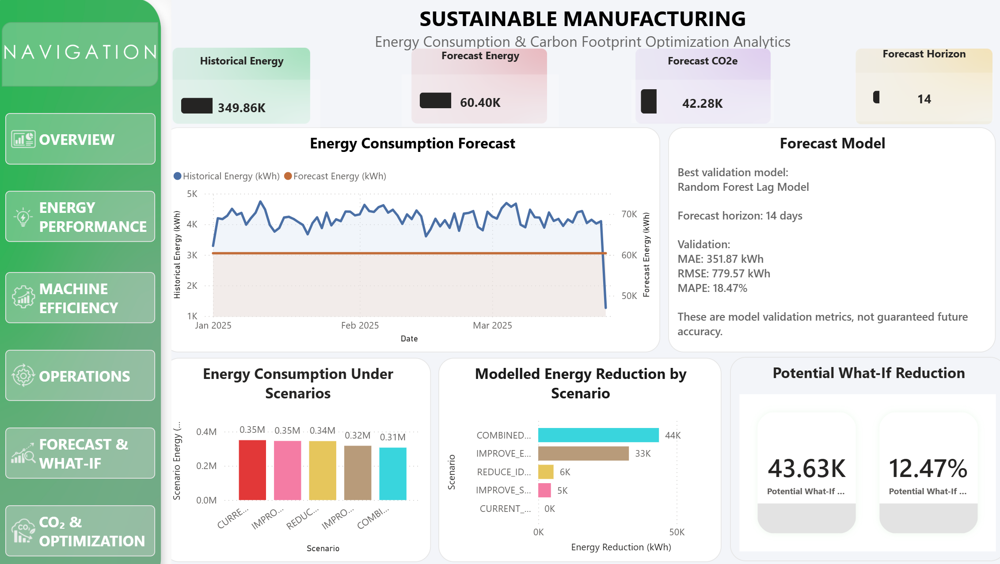
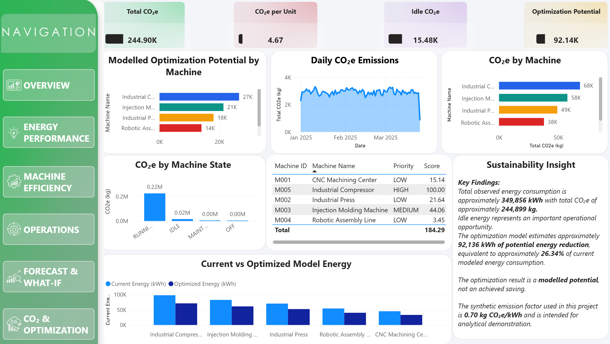

# Sustainable Manufacturing: Energy Consumption & Carbon Footprint Optimization Analytics

A data analytics project focused on understanding manufacturing energy consumption, identifying operational inefficiencies, forecasting future energy demand, and evaluating opportunities to reduce energy use and carbon emissions.

## 🏗️ Project Architecture

The project follows a modular analytics pipeline that transforms manufacturing data into actionable energy and sustainability insights.



### Analytics Modules

| Module | Purpose |
|---|---|
| Data Cleaning | Handle missing values and validate data |
| EDA | Explore energy, production, and machine patterns |
| Baseline | Establish reference energy consumption |
| Inefficiency Analysis | Identify potential energy inefficiencies |
| Forecasting | Forecast future energy demand |
| What-If Analysis | Evaluate hypothetical energy-saving scenarios |
| CO₂ Analysis | Estimate carbon emissions |
| Optimization | Evaluate potential energy reduction opportunities |
| Recommendations | Translate findings into actionable suggestions |

*Note: The diagram represents the intended analytical workflow. The exact execution order and dependencies may differ between individual scripts.*

## Project Overview

Manufacturing operations consume energy across different machines, operating states, and production schedules. Understanding these patterns can help organizations identify inefficiencies and make better operational decisions.

This project uses Python-based data analytics, forecasting, scenario analysis, optimization, and Power BI to explore energy performance and sustainability opportunities.

**Important:** The project dataset is synthetic. The emission factor and savings estimates are for analytical demonstration and must not be interpreted as verified industrial measurements or achieved savings.

## Objectives

- Analyze manufacturing energy consumption and production.
- Clean and validate the dataset.
- Develop an energy baseline.
- Identify potential energy inefficiencies.
- Forecast future energy consumption.
- Evaluate What-If improvement scenarios.
- Analyze carbon dioxide equivalent (CO₂e) emissions.
- Model energy optimization opportunities.
- Generate actionable management recommendations.
- Present findings through a Power BI dashboard.

## Technologies Used

- Python
- Pandas and NumPy
- Matplotlib
- Scikit-learn
- SciPy optimization
- Flask for the mock API
- Excel and CSV
- Power BI
- Git and GitHub

## Analytics Workflow

1. Exploratory Data Analysis (EDA)
2. Data Cleaning and Validation
3. Energy Baseline Development
4. Inefficiency Analysis
5. Energy Forecasting
6. What-If Scenario Analysis
7. CO₂e and Sustainability Analysis
8. Linear Programming Optimization
9. Management Recommendations
10. Power BI Dashboard Reporting

## Dataset

The project uses a synthetic manufacturing energy dataset containing **10,000 records** and **31 original columns**, covering five machines.

The dataset includes information about timestamps, machine states, energy consumption, production, baseline energy, environmental conditions, and emissions-related fields.

The dataset is provided in the `data/` directory.

## 📊 Power BI Dashboard Preview

The Power BI dashboard presents an interactive view of manufacturing energy consumption, machine efficiency, production operations, forecasting scenarios, and carbon footprint optimization.

### 1. Overview


### 2. Energy Performance


### 3. Machine Efficiency


### 4. Operations


### 5. Forecast & What-If Analysis


### 6. CO₂ & Optimization


## 📈 Key Findings & Results

The analysis of 10,000 synthetic manufacturing records provides insights into energy consumption, production efficiency, and carbon emissions.

### Key Performance Indicators (KPIs)

| Metric | Result |
|---|---:|
| Total Energy Consumption | 349,856.35 kWh |
| Total Production | 52,491.21 units |
| Total CO₂e Emissions | 244,899.45 kg CO₂e |
| Idle Energy Consumption | 22,120.85 kWh |
| Idle CO₂e Emissions | 15,484.59 kg CO₂e |
| Energy per Production Unit | 6.67 kWh/unit |
| CO₂e per Production Unit | 4.67 kg CO₂e/unit |

### Key Analytical Insights

- **Energy performance:** Actual modelled energy consumption was 17,105.85 kWh above the established baseline.
- **Idle energy:** Idle operations accounted for 22,120.85 kWh of energy consumption, identifying an opportunity to improve machine shutdown and scheduling practices.
- **Machine sustainability:** The industrial compressor (M005) had the highest reported CO₂e per production unit, at approximately 13.19 kg CO₂e/unit.
- **Energy forecasting:** The forecasting module generates a 14-day energy demand forecast to support production planning.
- **What-If analysis:** Scenario modelling estimates potential energy and emissions reductions under configurable assumptions.
- **Optimization:** The optimization module evaluates potential energy-saving opportunities subject to the model's assumptions and constraints.

### Important Interpretation Note

This project uses a synthetic dataset and a demonstration emission factor of 0.7 kg CO₂e/kWh. The results are analytical estimates based on the supplied data and modelling assumptions; they do not represent verified real-world factory performance or achieved savings.

Potential savings from What-If analysis and optimization are modelled scenarios, not guaranteed reductions.

## Key Results

The following figures are from the project's analytical runs:

| Metric | Result |
|---|---:|
| Dataset records | 10,000 |
| Machines analyzed | 5 |
| Total observed energy consumption | 349,856.35 kWh |
| Total production | 52,491.21 units |
| Total CO₂e | Approximately 244,899.45 kg |
| Idle energy consumption | 22,120.85 kWh |
| Forecast horizon | 14 days |
| Modelled optimization energy reduction | Approximately 92,136.35 kWh |
| Modelled optimization reduction | Approximately 26.34% |

The project uses a **synthetic emission factor of 0.70 kg CO₂e/kWh** for demonstration.

The optimization figures represent modelled potential under the project's assumptions, not measured or achieved savings. Forecasts are estimates and are not guarantees of future consumption.

## Project Structure

```text
Sustainable_Manufacturing_Analytics_ID_Pass/
├── data/
│   └── Sustainable_Manufacturing_Energy_Analytics_10000.xlsx
├── src/
│   ├── library/
│   ├── main.py
│   ├── auth.py
│   ├── eda.py
│   ├── data_cleaning.py
│   ├── baseline.py
│   ├── inefficiency_analysis.py
│   ├── forecasting.py
│   ├── what_if_analysis.py
│   ├── co2_analysis.py
│   ├── optimization.py
│   └── recommendations.py
├── outputs/                 # Generated locally; excluded from Git
├── .env.example
├── .gitignore
├── requirements.txt
├── run_pipeline.py
└── README.md
```

## Getting Started

```bash
git clone https://github.com/mahtab4builds/Sustainable-Manufacturing-Analytics.git
cd Sustainable-Manufacturing-Analytics
```

### 2. Create a virtual environment

Windows PowerShell:

```powershell
python -m venv .venv
.\.venv\Scripts\Activate.ps1
```

### 3. Install dependencies

```powershell
pip install -r requirements.txt
```

### 4. Configure environment variables

Create a local `.env` file based on `.env.example`. Set the configuration required by the application, including your own credentials.

**Never commit `.env` or publish real passwords, API keys, or tokens.**

### 5. Run the project

Follow the entry point and configuration supported by the source code. The main pipeline launcher is `run_pipeline.py`; check its implementation and the project's configuration before running it.

Generated analytical files are written to the configured output directories and are excluded from Git by default.

## Power BI Dashboard

The planned report is organized into six pages:

1. Executive Overview
2. Energy Performance
3. Machine Efficiency
4. Production & Operations
5. Forecast & What-If
6. CO₂ & Optimization

Add dashboard screenshots and the Power BI report file if they are suitable for public sharing and do not contain confidential information.

## Limitations

- The dataset is synthetic and may not represent real manufacturing operations.
- The emission factor is illustrative and should be replaced with an appropriate, documented factor for real-world reporting.
- Forecast performance depends on the available data and validation methodology.
- What-If and optimization outputs depend on model assumptions and constraints.
- Potential savings require real-world measurement and validation before being claimed as achieved.

## Future Improvements

- Integrate a production data API.
- Validate the analysis using real manufacturing data.
- Improve forecasting and optimization methods.
- Add automated reporting and monitoring.
- Expand Power BI dashboard documentation.

## Author

**Mahtab Alam Ansari**

BCA | Data Analytics Project

---

*Developed as a sustainable manufacturing analytics project using Python and Power BI.*